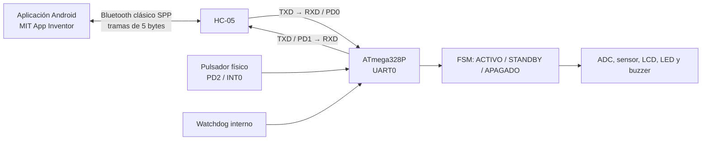

# Diagrama de comunicación — Problema B

El ATmega328P funciona a 16 MHz. La UART0 está configurada a 9600 bit/s, 8 bits de datos, sin paridad y un bit de parada (8N1). El HC-05 actúa como puente serie Bluetooth clásico entre la aplicación Android y la UART0.

| Estado | CPU | UART/Bluetooth | Fuente de despertar prevista |
| --- | --- | --- | --- |
| ACTIVO | Ejecuta tareas | Disponible | Eventos normales |
| STANDBY | Idle entre tareas | Disponible | Interrupciones y comandos recibidos |
| APAGADO | Power-Down | Deshabilitada por PRUSART0 | INT0 o interrupción del WDT |

En APAGADO no se reciben comandos Bluetooth: la UART convencional está deshabilitada. El botón físico es la vía de recuperación local prevista. La aplicación debe mostrar pérdida de comunicación o falta de respuesta, sin prometer que puede despertar al microcontrolador por Bluetooth.

Este diagrama describe las conexiones y el comportamiento previstos por el firmware. La comunicación efectiva se documentará con registros de tramas recibidas y transmitidas en la evidencia del punto 5.
